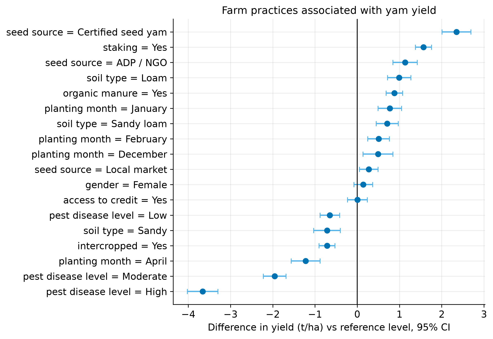
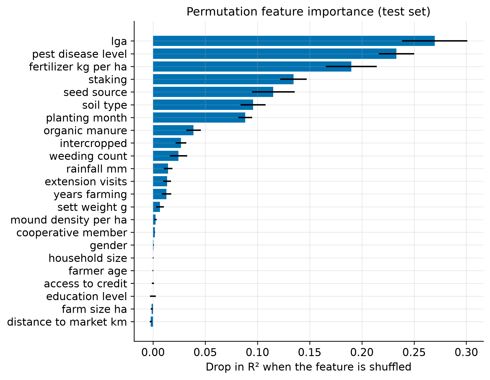

# Farm practices associated with yam yield in Nasarawa State: a reproducible data science analysis

**Group_03** · NSUK Python for Data Science Workshop 2026 · Group project

**Authors:** *Victor Ochoche, Ahamefula Okpara, Nathaniel Christian Chidi, Bisala Bwejua Caleb, Tavershima Ngutor Moses,Njeni John Okachi*

> *How to use this template: replace every line in italics with your own writing, then delete the guidance. Each
> section lists who usually drafts it, but agree this in your group. Target length: **1,500–2,500 words**, plus figures
> and tables. Every number must come from your notebook. To include a figure:*
> ``

---

## Abstract *(Member 5, written last, ~150 words)*
*This study asked which farm practices are associated with higher yam yield among smallholder farmers in Nasarawa State. We analysed a synthetic survey of 2,436 farm records from 13 local government areas; 2,360 farms remained after cleaning. Methods were data cleaning, Welch t-tests, chi-square tests, multiple regression and machine learning with cross-validation. Staked farms yielded 1.63 t/ha more than unstaked farms (95% CI [1.40, 1.85]). In the regression (n = 1,846; adjusted R² = .60), certified seed (+2.20 t/ha) and staking (+1.56 t/ha) were associated with higher yield, and high pest and disease pressure with lower yield (−3.68 t/ha). The raw yield gap for women (−0.33 t/ha) was not significant after adjustment. A linear regression predicted yield on unseen farms with a mean absolute error of 1.42 t/ha. In this dataset, pest control, improved seed and staking were most strongly associated with yield, but these are associations, not causal effects.*

## 1. Introduction and research question *(Member 5 or Coordinator)*
*Yam is a major staple crop in Nigeria, grown both for household food and as a cash crop, and Nigeriaproduces roughly two thirds of the world's yam (Kleih et al., 2012). Most of it is grown by smallholder farmers, so differences in yield matter for food security and household income. Nasarawa State, in Nigeria's North Central region, is a yam-growing state, and yield varies widely between farms. Farmers, extension workers and policy makers therefore need to know which practices are associated with higher yield, and whether access to resources such as credit, extension visits and improved seed is shared equally between men and women.
This report analyses a farm survey to answer that question. It follows a complete, reproducible
workflow: auditing and cleaning the data, exploratory analysis, hypothesis tests, multiple
regression to explain yield, and a machine learning model to predict yield before harvest. All
steps are in one notebook, and the final model is available in a small web app.

**The data are synthetic.** They were generated for teaching at the NSUK Python for Data Science
Workshop 2026 and do not describe real farms. All findings below are therefore properties of this dataset, not evidence about farms in Nasarawa State. The data contain 2,436 survey records from 13 local government areas (LGAs); after cleaning, 2,360 farms were analysed.

**Research question.** Which farm practices are associated with higher yam yield among smallholder farmers in Nasarawa State?
- **H1:** Farms that stake their yam vines have a higher mean yield than farms that do not.
- **H2:** Cooperative members are more likely to have access to credit.
- **H3:** Mean yield differs between male and female farmers.
Because the data come from an observational survey, we describe associations and do not claim that any practice causes higher yield.

**REFERENCE** Kleih, U., Phillips, D., Mignouna, D., Ogbonna, M., & Siwoku, B. (2012). *Nigeria: Scoping yam value chain analysis*. Yam Improvement for Income and Food Security in West Africa (YIIFSWA), International Institute of Tropical Agriculture. https://gatesopenresearch.org/documents/3-86/pdf*

## 2. Data and cleaning *(Member 1)*
### 2.1 The dataset
*Describe the survey: number of rows and columns, what one row represents, the outcome variable and its unit, and the main groups of variables (farmer, practices, environment, outcomes). Refer to `data/README.md`.*

### 2.2 Data-quality problems and how we fixed them
*Paste and complete your audit table from Part 1.9: problem → columns → how many rows → fix. Then give the final number of farms after cleaning and explain why missing values were **not** filled in at this stage.*

| Problem | Columns | Rows affected | Fix |
|---|---|---|---|
| | | | |

### 2.3 Leaky variables
*Which two columns were excluded from prediction, and why?*

## 3. Exploratory analysis *(Member 2)*
*Describe the distribution of yield (mean, SD, range) and your 3–5 key findings from Part 3, each with a number. Include at least one figure. Discuss the curved rainfall relationship and what the gender comparison tables showed.*

## 4. Hypothesis tests *(Member 3)*
*Report H1 (staking, Welch's t-test), H2 (cooperative × credit, chi-square) and H3 (gender, t-test) in APA style with effect sizes and confidence intervals. Example:*
> *Farms that staked their vines had a higher mean yield than farms that did not (difference = __ t/ha, 95% CI [__, __]), Welch's t = __, p < .001, Cohen's d = __.*

*Include Table 1 (descriptive statistics by staking).*

## 5. Regression analysis *(Member 3)*
*Which variables were in the model, how many rows were used (and why fewer than the cleaned total), and the adjusted R². Interpret the 4–6 most important coefficients with their 95% CIs (direction, size, unit). Explain what the squared terms show. **Discuss the gender gap:** raw difference vs adjusted difference, and what this suggests. Include Figure 2 (coefficient plot). Mention the assumption checks.*

## 6. Predicting yield with machine learning *(Member 4)*
*Features used, train/test split, the four models compared (include Table 3 from `results/table3_model_comparison_cv.csv`), which model was chosen and why, and the test-set R², MAE and RMSE in plain words ("predictions are typically within about __ t/ha"). Explain the leakage experiment in your own words. Include Figures 3 and 4 and comment on feature importance (and why importance ≠ causation).*

## 7. The Streamlit app *(Member 5)*
*What the app does, who could use it, and how to run it. Include 2–3 screenshots. Mention its limitations (synthetic data, only valid within the ranges seen in training, not causal).*

## 8. Discussion and limitations *(everyone)*
*What do the results mean together? Which practices seem most promising for farmers or extension officers? Limitations: synthetic data; observational (association, not causation); missing data and listwise deletion in the regression; possible unmeasured confounders; model only valid for farms similar to the training data.*

## 9. Conclusion *(Member 5)*
*3–5 sentences answering the research question.*

## 10. What we learned as a team *(everyone, ~1 short paragraph each, optional but encouraged)*
*What was hard, what you would do differently, and how you used Git and GitHub together.*

---

## References
*Only cite sources you have actually read. Check every reference exists, because AI tools invent references. If you cite nothing, delete this section.*

## Appendix: reproducibility
- Repository: *link*
- Run: `pip install -r requirements.txt` → open `notebooks/group_project.ipynb` → **Run All** → `streamlit run app/streamlit_app.py`
- AI use: see [`docs/AI_USE_STATEMENT.md`](../docs/AI_USE_STATEMENT.md)
- Contributions: see [`CONTRIBUTIONS.md`](../CONTRIBUTIONS.md)
