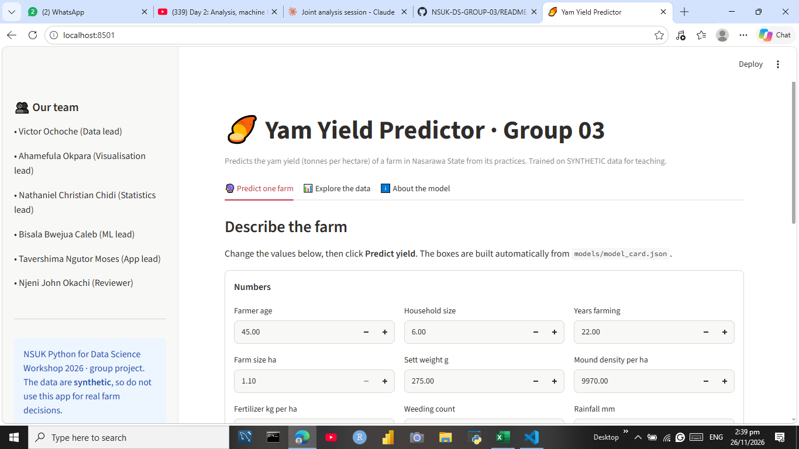
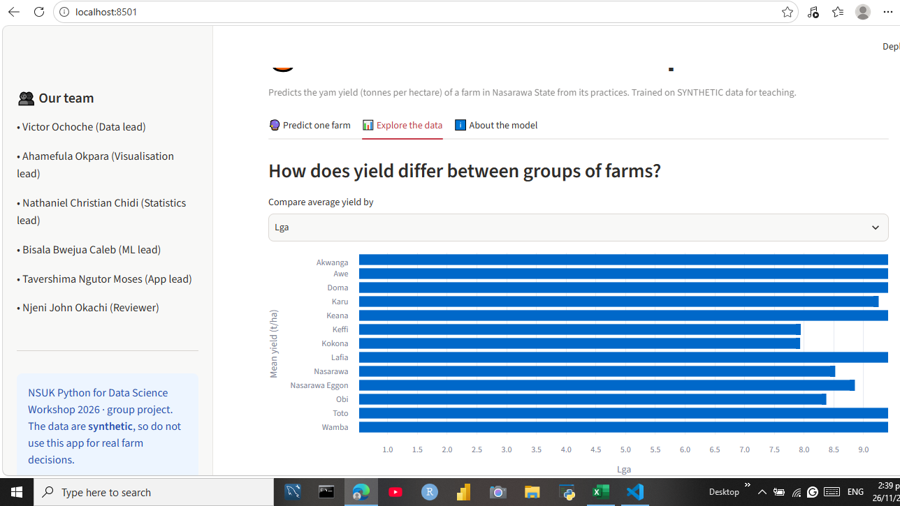
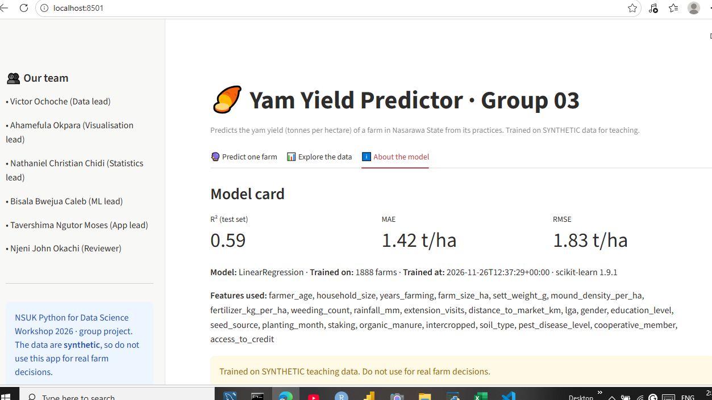

# Farm practices associated with yam yield in Nasarawa State: a reproducible data science analysis

**Group_03** · NSUK Python for Data Science Workshop 2026 · Group project

**Authors:** *Victor Ochoche, Ahamefula Okpara, Nathaniel Christian Chidi, Bisala Bwejua Caleb, Tavershima Ngutor Moses,Njeni John Okachi*

> *How to use this template: replace every line in italics with your own writing, then delete the guidance. Each
> section lists who usually drafts it, but agree this in your group. Target length: **1,500–2,500 words**, plus figures
> and tables. Every number must come from your notebook. To include a figure:*
> ``

---

## Abstract *(Member 5, written last, ~150 words)*
*This study asked which farm practices are associated with higher yam yield among smallholder farmers in Nasarawa State. We analysed a synthetic survey of 2,436 farm records from 13 local government areas; 2,360 farms remained after cleaning. Methods were data cleaning, Welch t-tests, chi-square tests, multiple regression and machine learning with cross-validation. Staked farms yielded 1.63 t/ha more than unstaked farms (95% CI [1.40, 1.85]). In the regression (n = 1,846; adjusted R² = .60), certified seed (+2.20 t/ha) and staking (+1.56 t/ha) were associated with higher yield, and high pest and disease pressure with lower yield (−3.68 t/ha). The raw yield gap for women (−0.33 t/ha) was not significant after adjustment. A linear regression predicted yield on unseen farms with a mean absolute error of 1.42 t/ha. In this dataset, pest control, improved seed and staking were most strongly associated with yield, but these are associations, not causal effects.*

## 1. Introduction and research question *(Member 5 or Coordinator)*
*Yam is a major staple crop in Nigeria, grown both for household food and as a cash crop, and Nigeriaproduces roughly two thirds of the world's yam (Kleih et al., 2012). Most of it is grown by smallholder farmers, so differences in yield matter for food security and household income. Nasarawa State, in Nigeria's North Central region, is a yam-growing state, and yield varies widely between farms. Farmers, extension workers and policy makers therefore need to know which practices are associated with higher yield, and whether access to resources such as credit, extension visits and improved seed is shared equally between men and women.
This report analyses a farm survey to answer that question. It follows a complete, reproducible
workflow: auditing and cleaning the data, exploratory analysis, hypothesis tests, multiple
regression to explain yield, and a machine learning model to predict yield before harvest. All
steps are in one notebook, and the final model is available in a small web app.

**The data are synthetic.** They were generated for teaching at the NSUK Python for Data Science
Workshop 2026 and do not describe real farms. All findings below are therefore properties of this dataset, not evidence about farms in Nasarawa State. The data contain 2,436 survey records from 13 local government areas (LGAs); after cleaning, 2,360 farms were analysed.

**Research question.** Which farm practices are associated with higher yam yield among smallholder farmers in Nasarawa State?
- **H1:** Farms that stake their yam vines have a higher mean yield than farms that do not.
- **H2:** Cooperative members are more likely to have access to credit.
- **H3:** Mean yield differs between male and female farmers.
Because the data come from an observational survey, we describe associations and do not claim that any practice causes higher yield.

**REFERENCE** Kleih, U., Phillips, D., Mignouna, D., Ogbonna, M., & Siwoku, B. (2012). *Nigeria: Scoping yam value chain analysis*. Yam Improvement for Income and Food Security in West Africa (YIIFSWA), International Institute of Tropical Agriculture. https://gatesopenresearch.org/documents/3-86/pdf*

## 2. Data and cleaning *(Member 1)*
### 2.1 The dataset
*The data come from a synthetic farm-level survey of yam growers in Nasarawa State, provided as
`data/raw/nasarawa_yam_survey_synthetic.csv`.
The raw file has **2,436 rows and 28 columns**. Each row is one farm surveyed in one year between2021 and 2025. After removing duplicate entries, there are 2,400 distinct farms, each appearing once, so the farms are not followed over time. The farms are spread over 13 local government areas(LGAs).

The **outcome variable** is yield, `yield_t_per_ha`, measured in tonnes per hectare (t/ha). The othercolumns fall into the following groups:
| Group | Variables |
|---|---|
| Identification and place | `farm_id`, `survey_year`, `lga` |
| Farmer and household | `gender`, `farmer_age`, `education_level`, `household_size`, `years_farming` |
| Farm | `farm_size_ha`, `soil_type` |
| Farming practices | `seed_source`, `sett_weight_g`, `mound_density_per_ha`, `planting_month`, `staking`, `fertilizer_kg_per_ha`, `organic_manure`, `intercropped`, `weeding_count` |
| Environment and pests | `rainfall_mm`, `pest_disease_level` |
| Access and market | `extension_visits`, `cooperative_member`, `access_to_credit`, `distance_to_market_km` |
| Outcomes | `yield_t_per_ha` (target), `tubers_harvested_per_ha`, `harvest_revenue_naira` |

Two of the outcome columns, `tubers_harvested_per_ha` and `harvest_revenue_naira`, are only known after harvest and are almost determined by yield, so they were excluded from all explanatory and predictive models. The identifier `farm_id` and the year were also not used as features.*

### 2.2 Data-quality problems and how we fixed them
*We audited the raw file in Part 1 of the notebook and fixed each problem in Part 2, one step at a time, on a copy of the data. The raw file was never changed.*

| Problem | Columns | Rows affected | Fix |
|---|---|---|---|
| Duplicate rows | all | 36 | Dropped the repeated copies. |
| Inconsistent spelling and spaces | `lga` | 351 (49 spellings for 13 LGAs) | Stripped spaces, fixed capital letters, and mapped variants (`N/Eggon`, `Nasarawa-Eggon`, `Nassarawa`, `Akwaga`) to the correct LGA. |
| Yes/No written many ways | `staking`, `organic_manure`, `intercropped`, `cooperative_member`, `access_to_credit` | 960 | Stripped spaces, lowercased, and mapped y/yes to Yes and n/no to No. |
| Male/Female written many ways | `gender` | 241 | Stripped spaces, lowercased, and mapped m/male to Male and f/female to Female. |
| Month written many ways | `planting_month` | 568 | Mapped abbreviations and number codes (`Feb`, `02`) to full month names. |
| Numbers stored as text | `fertilizer_kg_per_ha`, `harvest_revenue_naira` | 685 | Fertiliser: "nil", "not recorded" and "-" set to missing. Revenue: removed the ₦ and N signs and commas. Both converted to numbers. |
| -999 used as a missing code | `rainfall_mm` | 28 | Replaced -999 with a missing value. |
| Impossible values | `farmer_age`, `farm_size_ha`, `mound_density_per_ha`, `yield_t_per_ha` | 35 (age 15, farm size 9, mound density 7, yield 4) | Set values outside valid ranges to missing: age 15 to 90, farm size 0.05 to 50 ha, mound density 2,000 to 25,000 per ha, yield 0.5 to 40 t/ha. |
| Missing values | 10 columns | 1.6% to 6.0% per column (largest: `sett_weight_g` 145, `extension_visits` 123, `soil_type` 122) | Left as missing at this stage; filled later inside the model pipeline (see below). |
| Leaky columns | `harvest_revenue_naira`, `tubers_harvested_per_ha` | 2 columns | Never used as model features, because they are only known after harvest. |

*Counts are from the raw file, before duplicates were removed.

**Final data.** The file started with 2,436 rows. Removing duplicates left 2,400 farms. We then
dropped the 40 farms with no valid yield (a missing yield, or an impossible one set to missing), because a farm without an outcome cannot be used to study yield. The cleaned data contain **2,360 farms** and were saved to `data/processed/`.

**Why missing values were not filled in at this stage.** Filling gaps with a typical value (such as the median) uses information from the whole dataset. If we did that before splitting the data, the test farms would influence the values used to train the model, and the model's test score would look better than it really is. We therefore left the gaps as they are, and the model pipeline fills them in using the training farms only (and, during cross-validation, only the training part of each fold). The multiple regression in Part 5 uses only farms with complete data (1,846 of 2,360).*

### 2.3 Leaky variables
*Two columns were excluded from all models because they are only known **after** the harvest:

- **`tubers_harvested_per_ha`**, the number of tubers dug up per hectare. Yield is roughly the
  number of tubers times the average tuber weight, so this column is almost the outcome itself
  (correlation with yield *r* = .92).
- **`harvest_revenue_naira`**, the money earned from selling the harvest. It is calculated from theyield, the farm size and the price, so it contains the answer.

Including them is called target leakage: the model would use information that does not exist when afarmer wants a prediction. We tested this on purpose. Adding tubers harvested per hectare raised the cross-validated *R*² of a gradient boosting model from 0.62 to 0.87, and cut the average error from 1.44 to 0.81 t/ha. That improvement is not real skill, because a farmer cannot supply the number of tubers before harvesting them. We therefore reported only the model that uses features known before harvest, and used the question "would a farmer have this value at prediction time?" to check every feature.*

## 3. Exploratory analysis *(Member 2)*

### 3.1 Distribution of yield

Yield is roughly symmetric and bell-shaped (Figure 1 in the notebook). Across the 2,360 cleaned farms the mean is 9.64 t/ha (SD 2.94) and the median 9.71 t/ha, with a range of 1.5 to 18.7 t/ha and skewness of -0.08. There are no extreme outliers after cleaning, and the middle half of farms yield between 7.7 and 11.6 t/ha. No transformation of the outcome was needed.

### 3.2 Key findings

1. **Yield differs strongly by location.** Mean yield ranged from 7.94 t/ha in Kokona and 7.95 t/ha in Keffi to 11.10 t/ha in Akwanga, 11.00 in Toto and 10.92 in Wamba (one-way ANOVA across the 13 LGAs, *F*(12, 2347) = 27.10, *p* < .001).
2. **Pests, seed and staking go with the largest differences.** Mean yield fell steadily with pest and disease level, from 10.65 t/ha when absent to 7.00 t/ha when high. It rose from 9.12 t/ha with farmers' own saved setts to 11.46 t/ha with certified seed yam, and was higher on staked farms (10.46 vs 8.83 t/ha). Organic manure was also associated with higher yield (10.11 vs 9.37 t/ha) and intercropping with lower yield (9.29 vs 10.06 t/ha). Planting in April gave the lowest mean yield (8.19 t/ha), against 10.17 t/ha in January. Figure 1 shows the staking advantage within each seed source, and Table 1 compares staked and unstaked farms.
3. **Fertiliser is the strongest numeric predictor.** Its correlation with yield was *r* = .32, and mean yield rose from 8.41 t/ha in the lowest-fertiliser group to 11.40 t/ha in the highest.
4. **Rainfall has a curved relationship with yield.** Its straight-line correlation was almost zero (*r* = .07), which suggests no effect, but grouping farms by rainfall shows a hill shape: mean yield was 8.35 t/ha in the driest group, peaked at about 10.2 t/ha for 1,200 to 1,325 mm, and fell to 9.11 t/ha in the wettest group. Too little and too much rain are both associated with lower yield. A correlation coefficient only measures straight-line relationships and misses this, so we model the curve explicitly in the regression.
5. **A post-harvest variable is almost the outcome.** Tubers harvested per hectare had a correlation of *r* = .92 with yield, which is why it was excluded from prediction (Section 2.3).

### 3.3 Gender comparison

Women (*n* = 655) had a slightly lower mean yield than men (*n* = 1,705): 9.40 vs 9.73 t/ha. They also hadmuch less access to inputs and support. Women farmed smaller plots (1.13 vs 1.52 ha), received about half as many extension visits (0.80 vs 1.53), and were less likely to have access to credit (13.9% vs 29.0%), to belong to a cooperative (28.4% vs 43.1%) or to stake their yam (35.1% vs 55.4%). Since staking alone is associated with about 1.6 t/ha higher yield, the small yield gap may reflect unequal access to resources and not gender itself. We test this idea with regression in Section 5.

## 4. Hypothesis tests *(Member 3)*

All tests use the 2,360 cleaned farms. We report effect sizes and 95% confidence intervals as well as
*p*-values, because a significant result does not show how large an effect is.

### 4.1 H1: staking and yield (Welch's t-test)
Farms that staked their vines had a higher mean yield (10.46 t/ha, *n* = 1,174) than farms that did not (8.83 t/ha, *n* = 1,186; difference = 1.63 t/ha, 95% CI [1.40, 1.85]), Welch's *t*(2358) = 13.99, *p* < .001, Cohen's *d* = 0.58, a medium effect. **H1 is supported.** Table 1 shows that staked and unstaked farms were very similar in fertiliser use, farm size and weeding, so these do not explain the difference. Staked farms did receive more extension visits (1.55 vs 1.11).

**Table 1.** Descriptive statistics by staking practice, mean (SD)

| Variable | Not staked | Staked |
|---|---|---|
| Yield (t/ha) | 8.83 (2.84) | 10.46 (2.81) |
| Fertiliser (kg/ha) | 108.84 (86.26) | 109.46 (90.64) |
| Farm size (ha) | 1.43 (1.84) | 1.40 (0.94) |
| Weeding count | 2.48 (0.86) | 2.48 (0.86) |
| Extension visits | 1.11 (1.28) | 1.55 (1.48) |
| *n* farms | 1,186 | 1,174 |

*Note.* Means exclude farms with a missing value for that variable (fertiliser 72, farm size 9,
extension visits 116 missing).

### 4.2 H2: cooperative membership and access to credit (chi-square test)

Cooperative members were more likely to have access to credit (40.8%, 376 of 921) than non-members (14.6%, 210 of 1,439), χ²(1, *N* = 2,360) = 205.63, *p* < .001, Cramér's *V* = .30, a medium association. The expected count in every cell was above 228, so the test's assumption was met. **H2 is supported.** The test shows an association only: it cannot say whether cooperatives help members obtain credit, or whether farmers with credit are more likely to join.

### 4.3 H3: gender and yield (Welch's t-test)

Male farmers had a slightly higher mean yield (9.73 t/ha, *n* = 1,705) than female farmers (9.40 t/ha, *n* = 655; difference = 0.33 t/ha, 95% CI [0.07, 0.59]), Welch's *t*(1214) = 2.47, *p* = .014, Cohen's *d* = 0.11. **H3 is supported, but the effect is small.** Women also had much less access to credit, extension and staking (Section 3.3), so this difference should not be read as an effect of gender itself. We examine this in the regression (Section 5), where it is no longer significant.

### 4.4 Additional test: seed source (one-way ANOVA)

Mean yield differed between the four seed sources, *F*(3, 2356) = 49.86, *p* < .001, η² = .06 (a medium effect). Yield was highest for certified seed yam (11.46 t/ha) and lowest for farmers' own saved setts (9.12 t/ha), with ADP/NGO seed (10.27) and local-market seed (9.50) in between. Tukey post-hoc comparisons found that every pair of sources differed significantly (adjusted *p* < .05).

### 4.5 Note on interpretation

These tests compare groups of farms one factor at a time, so they describe associations and not causes. Because three hypotheses were tested, we also checked the least significant result: after a Bonferroni correction (multiplying each *p* by 3), the gender result remains significant (*p* ≈ .04), and the other two are unaffected.

## 5. Regression analysis *(Member 3)*

### 5.1 Model

A multiple linear regression (ordinary least squares) explained yield (t/ha) using 6 numeric and 9 categorical predictors: fertiliser, rainfall, mound density, sett weight, weeding count, extension visits, staking, organic manure, intercropping, planting month, soil type, access to credit, seed source, pest and disease level, and gender. Each category is compared with a reference level (No, March, Clay loam, Own saved setts, Absent, Male). We added squared terms for rainfall and mound density, centred at 1,260 mm and 10,000 mounds per hectare. The two post-harvest columns were not used, and LGA was not included.

The model used **1,846 of the 2,360 cleaned farms**. Regression drops every farm with a missing value in any predictor, so 514 farms (22%) were excluded. The model explained about 60% of the variation in yield (*R*² = .605, adjusted *R*² = .599, *F*(26, 1819) = 107.2, *p* < .001). Adding the squared terms raised the adjusted *R*² from .523 to .599.

### 5.2 Main results

Estimates are changes in yield (t/ha) holding all other predictors constant (Figure 2 and Table 2).

- **Pests and disease.** Yield was lower than on farms with no pests by 0.57 t/ha at the low level (95% CI [-0.78, -0.36]), 1.97 t/ha at the moderate level ([-2.22, -1.72]) and **3.68 t/ha at the high level ([-4.01, -3.34])**, the largest effect in the model.
- **Seed source.** Certified seed yam was associated with **2.20 t/ha higher yield** than farmers' own saved setts (95% CI [1.89, 2.51]), and ADP/NGO seed with 1.13 t/ha higher ([0.87, 1.39]).
- **Staking.** Staked farms yielded 1.56 t/ha more (95% CI [1.38, 1.74]).
- **Fertiliser.** Each additional 100 kg/ha was associated with 1.12 t/ha higher yield
  (95% CI [1.02, 1.22]).
- **Intercropping.** Intercropped farms yielded 0.77 t/ha less (95% CI [-0.94, -0.60]).
- **Planting month.** Planting in April was associated with 1.30 t/ha lower yield than March
  (95% CI [-1.61, -0.99]), while January, February and December planting were 0.79, 0.47 and
  0.57 t/ha higher.

Organic manure (+0.84 t/ha), weeding (+0.43 t/ha per extra weeding) and extension visits (+0.21 t/ha per visit) were also positive, and soil type mattered (loam +1.08 and sandy loam +0.77 vs clay loam; sandy -0.72).

### 5.3 Curved effects

Both squared terms were negative and significant (*p* < .001). A negative squared term means a
hill-shaped relationship: there is a best level, and yield falls on either side of it. The estimated peaks were about **1,300 mm of rainfall** and about **10,500 mounds per hectare**. These effects were hidden before: in Section 3, rainfall's correlation with yield was close to zero, and in a model without squared terms, mound density was not significant (*p* = .18). Peaks are estimates from thisdataset and should not be read as recommendations.

### 5.4 The gender gap

In the raw comparison, women's mean yield was 0.33 t/ha lower than men's (*p* = .014). After adjusting for practices, inputs and conditions, the difference for women was **+0.20 t/ha (95% CI [-0.01, 0.40], *p* = .059)**, which is not significant and has the opposite sign. Adding staking alone removed most of the raw gap, and women were much less likely to stake (35% vs 55%), have credit (14% vs 29%), or belong to a cooperative (28% vs 43%), and received about half as many extension visits. Access to credit itself had no independent association with yield (+0.02 t/ha, 95% CI [-0.20, 0.23], *p* = .86).

In this dataset, the raw yield gap therefore appears to reflect unequal access to practices and
support, not gender itself. This suggests that extension services, staking materials and improved seed for women farmers could narrow the gap. The adjusted estimate is imprecise, so the data are consistent with no gender difference and do not show that women yield more.

### 5.5 Assumption checks

Residual plots showed no pattern. The residual spread was constant (Breusch-Pagan *p* = .262), and the residuals were approximately normal (skewness -0.02, excess kurtosis -0.17; the formal Shapiro-Wilk test gave *p* = .031, which is a trivial departure with 1,846 farms). Multicollinearity was low (all variance inflation factors below 2). A straight-line rainfall term had left a hill-shaped pattern in the residuals, and the squared terms removed it.

*Table 2.* Full coefficient table: `results/regression_coefficients.csv`.

## 6. Predicting yield with machine learning *(Member 4)*

### 6.1 Setup

The aim was to predict the yield of a farm from information known **before harvest**. We used 23
features: 11 numeric (farmer age, household size, years farming, farm size, sett weight, mound
density, fertiliser, weeding count, rainfall, extension visits, distance to market) and 12
categorical (LGA, gender, education, seed source, planting month, staking, organic manure, intercropping, soil type, pest and disease level, cooperative membership, access to credit). The two post-harvest columns were excluded (Section 2.3).

We kept 20% of farms as a test set (472 farms) and used the other 80% (1,888 farms) for training. The test set was not touched until the final evaluation. Missing values were filled (median for numbers, most frequent value for categories), numbers were scaled and categories were one-hot encoded inside a pipeline, so these values were learned from the training farms only.

### 6.2 Model comparison

We compared four models with 5-fold cross-validation on the training set (Table 3). The baseline
always predicts the average yield, and any useful model must clearly beat it.

**Table 3.** Cross-validated performance (training set)

| Model | R² (mean) | R² (sd) | MAE (t/ha) |
|---|---|---|---|
| Baseline (predict the mean) | -0.002 | 0.002 | 2.378 |
| Linear regression | 0.629 | 0.023 | 1.426 |
| Random forest | 0.468 | 0.019 | 1.705 |
| Gradient boosting | 0.623 | 0.015 | 1.439 |

All three models beat the baseline. Linear regression had the highest mean *R*², but its difference from gradient boosting (0.006) is smaller than the variation between folds (sd 0.015 to 0.023), so the two are practically equally good. The random forest was clearly worse. We chose **linear regression** because it performed as well as the more complex model and is simpler to explain. The relationships in this dataset are mostly additive and close to straight lines, which suits it.

### 6.3 Test-set performance

The chosen model was trained on all training farms and tested once. On the 472 unseen farms it reached *R*² = 0.59, MAE = 1.42 t/ha and RMSE = 1.83 t/ha (Figure 3). In plain words, **predictions are typically within about 1.4 t/ha of the true yield**, which is about 15% of the average yield (9.6 t/ha). About 44% of predictions were within 1 t/ha and about 75% within 2 t/ha. The test score is a little lower than the cross-validated score (0.59 vs 0.63), as expected, because the test set is small and was not used for tuning.

### 6.4 The leakage experiment

A colleague might suggest adding the number of tubers harvested per hectare, because it "makes the model much better". We tried it: the cross-validated *R*² of a gradient boosting model rose from 0.62 to 0.87, and the average error fell from 1.44 to 0.81 t/ha. But tubers are only counted when the crop is dug up, and yield is roughly the number of tubers multiplied by the average tuber weight. The model was therefore not learning anything about farm practices; it was reading the answer from a column that measures nearly the same thing. A farmer asking for a prediction before harvest cannot provide that number, so the model would be useless in practice. Cross-validation cannot catch this, because the leaky column is present in every fold. Only knowing when each variable is measured can. The result below uses only features known before harvest.

### 6.5 Which features matter?

We measured permutation importance on the test set: each feature in turn was shuffled, and the drop in *R*² shows how much the model relies on it (Figure 4). The most important features were **LGA** (drop 0.27), **pest and disease level** (0.23), **fertiliser** (0.19), **staking** (0.13), **seed source** (0.12), **soil type** (0.10) and **planting month** (0.09). Gender, access to credit, cooperative membership and farm size contributed almost nothing, which agrees with the regression.

**Importance is not causation.** Permutation importance describes what the *model uses to predict*, not what would happen if a farmer changed a practice. LGA is probably standing in for unmeasured local conditions such as climate, soil quality or market access, so a high importance does not mean that location itself raises yield. A feature can also rank high simply because it varies a lot across farms (as fertiliser does). To estimate the effect of a practice, use the regression coefficients in Section 5.

## 7. The Streamlit app *(Member 5)*

### 7.1 What the app does

We built a small web app, **Yam Yield Predictor**, that makes the final model usable without any code. It has three tabs:

- **Predict one farm.** The user describes a farm with boxes for the 11 numeric features (such as farm size, fertiliser and rainfall) and drop-down menus for the 12 categorical features (such as LGA, seed source and staking), then clicks *Predict yield*. The app shows the predicted yield in t/ha with its difference from the average yield in the data, and the expected total harvest for the farm in tonnes (predicted yield multiplied by farm size). The boxes are built automatically from the model card (`models/model_card.json`), so they always match the trained model.
- **Explore the data.** The user picks a category (for example staking, seed source or pest level) and sees the mean yield for each group as a bar chart and a table, plus the first 200 rows of the cleaned data.
- **About the model.** This tab reports the model's test-set *R*², MAE and RMSE, the number of training farms, the features used, and the full model card.

### 7.2 Who could use it

In this project the app is a teaching tool for students and instructors to see how a trained model turns farm information into a prediction. If a similar app were built on real survey data, extension officers and farmers' groups could use it to compare the expected yield of different practices on a farm before the season. It must not be used for real farm decisions with this version.

### 7.3 How to run it

From the project folder, with the virtual environment active and the packages installed
(`pip install -r requirements.txt`):

    streamlit run app/streamlit_app.py

The app opens in the browser at `http://localhost:8501`. It needs the trained model and model card
in `models/` (`yam_yield_model.joblib` and `model_card.json`), which are created by Part 6 of the notebook.

### 7.4 Limitations

- **The data are synthetic.** The app describes the patterns in a teaching dataset, not real farms, and carries a warning in its sidebar saying so.
- **Predictions are only valid within the ranges seen in training.** The input boxes are limited to the smallest and largest values in the training data, and the model should not be trusted outside them.
- **Predictions are not causal.** Changing an input shows what the model predicts for a farm with that description, not what would happen to a real farm if the practice were changed.
- **Predictions are uncertain.** On unseen farms the model is typically off by about 1.4 t/ha
  (*R*² = 0.59), and it only uses pre-harvest information in the survey, so factors not measured here (such as local weather events or management skill) are not accounted for.

## 8. Discussion and limitations *(everyone)*
*What do the results mean together? Which practices seem most promising for farmers or extension officers? Limitations: synthetic data; observational (association, not causation); missing data and listwise deletion in the regression; possible unmeasured confounders; model only valid for farms similar to the training data.*

## 9. Conclusion *(Member 5)*
*3–5 sentences answering the research question.*

## 10. What we learned as a team *(everyone, ~1 short paragraph each, optional but encouraged)*
*What was hard, what you would do differently, and how you used Git and GitHub together.*

---

## References
*Only cite sources you have actually read. Check every reference exists, because AI tools invent references. If you cite nothing, delete this section.*

## Appendix: reproducibility
- Repository: *link*
- Run: `pip install -r requirements.txt` → open `notebooks/group_project.ipynb` → **Run All** → `streamlit run app/streamlit_app.py`
- AI use: see [`docs/AI_USE_STATEMENT.md`](../docs/AI_USE_STATEMENT.md)
- Contributions: see [`CONTRIBUTIONS.md`](../CONTRIBUTIONS.md)
