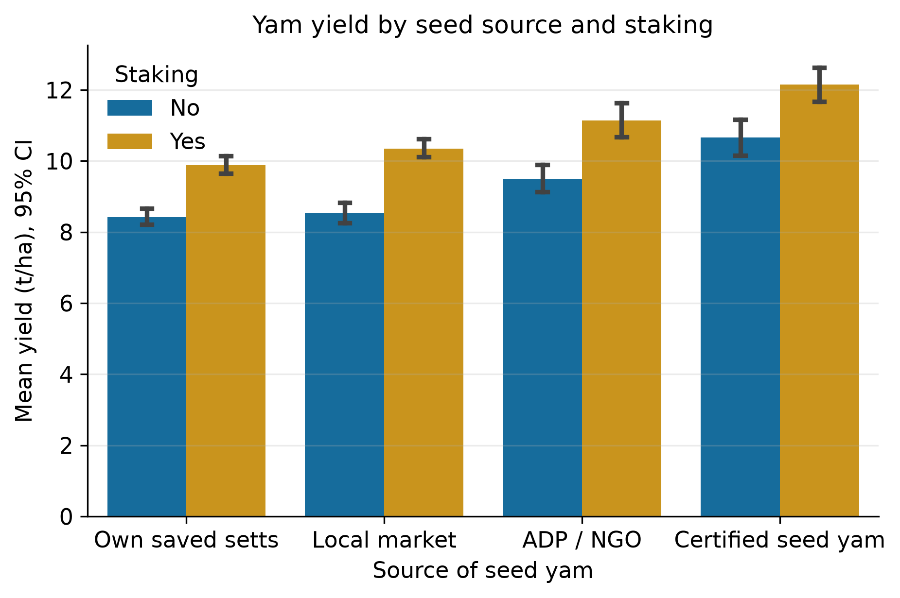
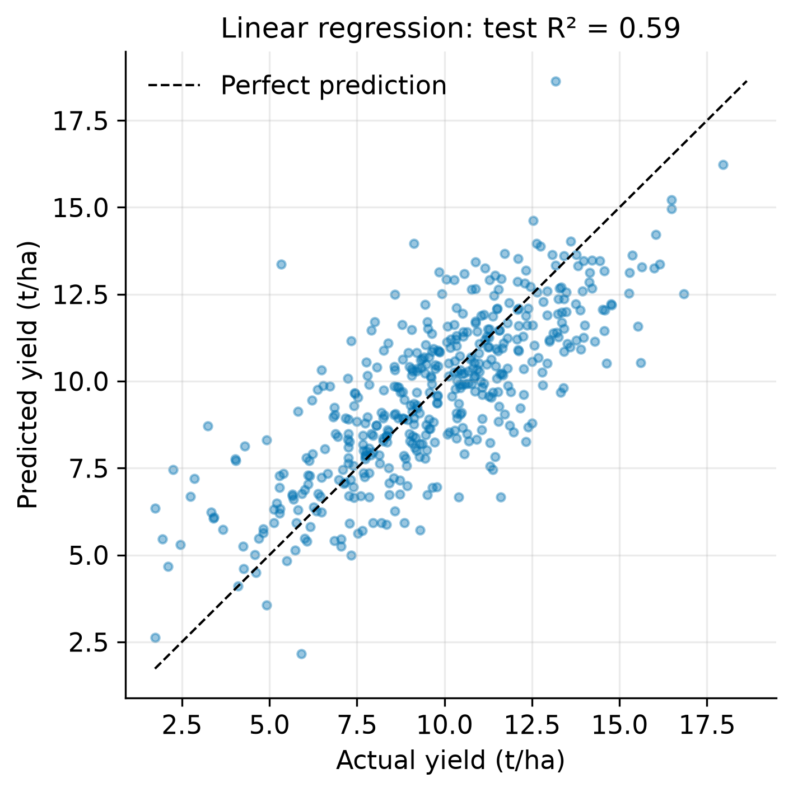

# Farm practices associated with yam yield in Nasarawa State: a reproducible data science analysis

**Group_03** · NSUK Python for Data Science Workshop 2026 · Group project

**Authors:** *Victor Ochoche, Ahamefula Okpara, Nathaniel Christian Chidi, Bisala Bwejua Caleb, Tavershima Ngutor Moses,Njeni John Okachi*

> *How to use this template: replace every line in italics with your own writing, then delete the guidance. Each
> section lists who usually drafts it, but agree this in your group. Target length: **1,500–2,500 words**, plus figures
> and tables. Every number must come from your notebook. To include a figure:*
> ``

---

## Abstract *(Member 5, written last, ~150 words)*
*This study asked which farm practices are associated with higher yam yield among smallholder farmers in Nasarawa State. We analysed a synthetic survey of 2,436 farm records from 13 local government areas; 2,360 farms remained after cleaning. Methods were data cleaning, Welch t-tests, chi-square tests, multiple regression and machine learning with cross-validation. Staked farms yielded 1.63 t/ha more than unstaked farms (95% CI [1.40, 1.85]). In the regression (n = 1,846; adjusted R² = .60), certified seed (+2.20 t/ha) and staking (+1.56 t/ha) were associated with higher yield, and high pest and disease pressure with lower yield (−3.68 t/ha). The raw yield gap for women (−0.33 t/ha) was not significant after adjustment. A linear regression predicted yield on unseen farms with a mean absolute error of 1.42 t/ha. In this dataset, pest control, improved seed and staking were most strongly associated with yield, but these are associations, not causal effects.*

## 1. Introduction and research question *(Member 5 or Coordinator)*
*Yam is a major staple crop in Nigeria, grown both for household food and as a cash crop, and Nigeriaproduces roughly two thirds of the world's yam (Kleih et al., 2012). Most of it is grown by smallholder farmers, so differences in yield matter for food security and household income. Nasarawa State, in Nigeria's North Central region, is a yam-growing state, and yield varies widely between farms. Farmers, extension workers and policy makers therefore need to know which practices are associated with higher yield, and whether access to resources such as credit, extension visits and improved seed is shared equally between men and women.
This report analyses a farm survey to answer that question. It follows a complete, reproducible
workflow: auditing and cleaning the data, exploratory analysis, hypothesis tests, multiple
regression to explain yield, and a machine learning model to predict yield before harvest. All
steps are in one notebook, and the final model is available in a small web app.

**The data are synthetic.** They were generated for teaching at the NSUK Python for Data Science
Workshop 2026 and do not describe real farms. All findings below are therefore properties of this dataset, not evidence about farms in Nasarawa State. The data contain 2,436 survey records from 13 local government areas (LGAs); after cleaning, 2,360 farms were analysed.

**Research question.** Which farm practices are associated with higher yam yield among smallholder farmers in Nasarawa State?
- **H1:** Farms that stake their yam vines have a higher mean yield than farms that do not.
- **H2:** Cooperative members are more likely to have access to credit.
- **H3:** Mean yield differs between male and female farmers.
Because the data come from an observational survey, we describe associations and do not claim that any practice causes higher yield.

**REFERENCE** Kleih, U., Phillips, D., Mignouna, D., Ogbonna, M., & Siwoku, B. (2012). *Nigeria: Scoping yam value chain analysis*. Yam Improvement for Income and Food Security in West Africa (YIIFSWA), International Institute of Tropical Agriculture. https://gatesopenresearch.org/documents/3-86/pdf*

## 2. Data and cleaning *(Member 1)*
### 2.1 The dataset
*The data come from a synthetic farm-level survey of yam growers in Nasarawa State, provided as
`data/raw/nasarawa_yam_survey_synthetic.csv`.
The raw file has **2,436 rows and 28 columns**. Each row is one farm surveyed in one year between2021 and 2025. After removing duplicate entries, there are 2,400 distinct farms, each appearing once, so the farms are not followed over time. The farms are spread over 13 local government areas(LGAs).

The **outcome variable** is yield, `yield_t_per_ha`, measured in tonnes per hectare (t/ha). The othercolumns fall into the following groups:
| Group | Variables |
|---|---|
| Identification and place | `farm_id`, `survey_year`, `lga` |
| Farmer and household | `gender`, `farmer_age`, `education_level`, `household_size`, `years_farming` |
| Farm | `farm_size_ha`, `soil_type` |
| Farming practices | `seed_source`, `sett_weight_g`, `mound_density_per_ha`, `planting_month`, `staking`, `fertilizer_kg_per_ha`, `organic_manure`, `intercropped`, `weeding_count` |
| Environment and pests | `rainfall_mm`, `pest_disease_level` |
| Access and market | `extension_visits`, `cooperative_member`, `access_to_credit`, `distance_to_market_km` |
| Outcomes | `yield_t_per_ha` (target), `tubers_harvested_per_ha`, `harvest_revenue_naira` |

Two of the outcome columns, `tubers_harvested_per_ha` and `harvest_revenue_naira`, are only known after harvest and are almost determined by yield, so they were excluded from all explanatory and predictive models. The identifier `farm_id` and the year were also not used as features.*

### 2.2 Data-quality problems and how we fixed them
*We audited the raw file in Part 1 of the notebook and fixed each problem in Part 2, one step at a time, on a copy of the data. The raw file was never changed.*

| Problem | Columns | Rows affected | Fix |
|---|---|---|---|
| Duplicate rows | all | 36 | Dropped the repeated copies. |
| Inconsistent spelling and spaces | `lga` | 351 (49 spellings for 13 LGAs) | Stripped spaces, fixed capital letters, and mapped variants (`N/Eggon`, `Nasarawa-Eggon`, `Nassarawa`, `Akwaga`) to the correct LGA. |
| Yes/No written many ways | `staking`, `organic_manure`, `intercropped`, `cooperative_member`, `access_to_credit` | 960 | Stripped spaces, lowercased, and mapped y/yes to Yes and n/no to No. |
| Male/Female written many ways | `gender` | 241 | Stripped spaces, lowercased, and mapped m/male to Male and f/female to Female. |
| Month written many ways | `planting_month` | 568 | Mapped abbreviations and number codes (`Feb`, `02`) to full month names. |
| Numbers stored as text | `fertilizer_kg_per_ha`, `harvest_revenue_naira` | 685 | Fertiliser: "nil", "not recorded" and "-" set to missing. Revenue: removed the ₦ and N signs and commas. Both converted to numbers. |
| -999 used as a missing code | `rainfall_mm` | 28 | Replaced -999 with a missing value. |
| Impossible values | `farmer_age`, `farm_size_ha`, `mound_density_per_ha`, `yield_t_per_ha` | 35 (age 15, farm size 9, mound density 7, yield 4) | Set values outside valid ranges to missing: age 15 to 90, farm size 0.05 to 50 ha, mound density 2,000 to 25,000 per ha, yield 0.5 to 40 t/ha. |
| Missing values | 10 columns | 1.6% to 6.0% per column (largest: `sett_weight_g` 145, `extension_visits` 123, `soil_type` 122) | Left as missing at this stage; filled later inside the model pipeline (see below). |
| Leaky columns | `harvest_revenue_naira`, `tubers_harvested_per_ha` | 2 columns | Never used as model features, because they are only known after harvest. |

*Counts are from the raw file, before duplicates were removed.

**Final data.** The file started with 2,436 rows. Removing duplicates left 2,400 farms. We then
dropped the 40 farms with no valid yield (a missing yield, or an impossible one set to missing), because a farm without an outcome cannot be used to study yield. The cleaned data contain **2,360 farms** and were saved to `data/processed/`.

**Why missing values were not filled in at this stage.** Filling gaps with a typical value (such as the median) uses information from the whole dataset. If we did that before splitting the data, the test farms would influence the values used to train the model, and the model's test score would look better than it really is. We therefore left the gaps as they are, and the model pipeline fills them in using the training farms only (and, during cross-validation, only the training part of each fold). The multiple regression in Part 5 uses only farms with complete data (1,846 of 2,360).*

### 2.3 Leaky variables
*Two columns were excluded from all models because they are only known **after** the harvest:

- **`tubers_harvested_per_ha`**, the number of tubers dug up per hectare. Yield is roughly the
  number of tubers times the average tuber weight, so this column is almost the outcome itself
  (correlation with yield *r* = .92).
- **`harvest_revenue_naira`**, the money earned from selling the harvest. It is calculated from theyield, the farm size and the price, so it contains the answer.

Including them is called target leakage: the model would use information that does not exist when afarmer wants a prediction. We tested this on purpose. Adding tubers harvested per hectare raised the cross-validated *R*² of a gradient boosting model from 0.62 to 0.87, and cut the average error from 1.44 to 0.81 t/ha. That improvement is not real skill, because a farmer cannot supply the number of tubers before harvesting them. We therefore reported only the model that uses features known before harvest, and used the question "would a farmer have this value at prediction time?" to check every feature.*

## 3. Exploratory analysis *(Member 2)*

### 3.1 Distribution of yield

Yield is roughly symmetric and bell-shaped (Figure 1 in the notebook). Across the 2,360 cleaned farms the mean is 9.64 t/ha (SD 2.94) and the median 9.71 t/ha, with a range of 1.5 to 18.7 t/ha and skewness of -0.08. There are no extreme outliers after cleaning, and the middle half of farms yield between 7.7 and 11.6 t/ha. No transformation of the outcome was needed.

### 3.2 Key findings

1. **Yield differs strongly by location.** Mean yield ranged from 7.94 t/ha in Kokona and 7.95 t/ha in Keffi to 11.10 t/ha in Akwanga, 11.00 in Toto and 10.92 in Wamba (one-way ANOVA across the 13 LGAs, *F*(12, 2347) = 27.10, *p* < .001).
2. **Pests, seed and staking go with the largest differences.** Mean yield fell steadily with pest and disease level, from 10.65 t/ha when absent to 7.00 t/ha when high. It rose from 9.12 t/ha with farmers' own saved setts to 11.46 t/ha with certified seed yam, and was higher on staked farms (10.46 vs 8.83 t/ha). Organic manure was also associated with higher yield (10.11 vs 9.37 t/ha) and intercropping with lower yield (9.29 vs 10.06 t/ha). Planting in April gave the lowest mean yield (8.19 t/ha), against 10.17 t/ha in January. Figure 1 shows the staking advantage within each seed source, and Table 1 compares staked and unstaked farms.
3. **Fertiliser is the strongest numeric predictor.** Its correlation with yield was *r* = .32, and mean yield rose from 8.41 t/ha in the lowest-fertiliser group to 11.40 t/ha in the highest.
4. **Rainfall has a curved relationship with yield.** Its straight-line correlation was almost zero (*r* = .07), which suggests no effect, but grouping farms by rainfall shows a hill shape: mean yield was 8.35 t/ha in the driest group, peaked at about 10.2 t/ha for 1,200 to 1,325 mm, and fell to 9.11 t/ha in the wettest group. Too little and too much rain are both associated with lower yield. A correlation coefficient only measures straight-line relationships and misses this, so we model the curve explicitly in the regression.
5. **A post-harvest variable is almost the outcome.** Tubers harvested per hectare had a correlation of *r* = .92 with yield, which is why it was excluded from prediction (Section 2.3).

### 3.3 Gender comparison

Women (*n* = 655) had a slightly lower mean yield than men (*n* = 1,705): 9.40 vs 9.73 t/ha. They also hadmuch less access to inputs and support. Women farmed smaller plots (1.13 vs 1.52 ha), received about half as many extension visits (0.80 vs 1.53), and were less likely to have access to credit (13.9% vs 29.0%), to belong to a cooperative (28.4% vs 43.1%) or to stake their yam (35.1% vs 55.4%). Since staking alone is associated with about 1.6 t/ha higher yield, the small yield gap may reflect unequal access to resources and not gender itself. We test this idea with regression in Section 5.

## 4. Hypothesis tests *(Member 3)*
*Report H1 (staking, Welch's t-test), H2 (cooperative × credit, chi-square) and H3 (gender, t-test) in APA style with effect sizes and confidence intervals. Example:*
> *Farms that staked their vines had a higher mean yield than farms that did not (difference = __ t/ha, 95% CI [__, __]), Welch's t = __, p < .001, Cohen's d = __.*

*Include Table 1 (descriptive statistics by staking).*

## 5. Regression analysis *(Member 3)*
*Which variables were in the model, how many rows were used (and why fewer than the cleaned total), and the adjusted R². Interpret the 4–6 most important coefficients with their 95% CIs (direction, size, unit). Explain what the squared terms show. **Discuss the gender gap:** raw difference vs adjusted difference, and what this suggests. Include Figure 2 (coefficient plot). Mention the assumption checks.*

## 6. Predicting yield with machine learning *(Member 4)*
*Features used, train/test split, the four models compared (include Table 3 from `results/table3_model_comparison_cv.csv`), which model was chosen and why, and the test-set R², MAE and RMSE in plain words ("predictions are typically within about __ t/ha"). Explain the leakage experiment in your own words. Include Figures 3 and 4 and comment on feature importance (and why importance ≠ causation).*

## 7. The Streamlit app *(Member 5)*
*What the app does, who could use it, and how to run it. Include 2–3 screenshots. Mention its limitations (synthetic data, only valid within the ranges seen in training, not causal).*

## 8. Discussion and limitations *(everyone)*
*What do the results mean together? Which practices seem most promising for farmers or extension officers? Limitations: synthetic data; observational (association, not causation); missing data and listwise deletion in the regression; possible unmeasured confounders; model only valid for farms similar to the training data.*

## 9. Conclusion *(Member 5)*
*3–5 sentences answering the research question.*

## 10. What we learned as a team *(everyone, ~1 short paragraph each, optional but encouraged)*
*What was hard, what you would do differently, and how you used Git and GitHub together.*

---

## References
*Only cite sources you have actually read. Check every reference exists, because AI tools invent references. If you cite nothing, delete this section.*

## Appendix: reproducibility
- Repository: *link*
- Run: `pip install -r requirements.txt` → open `notebooks/group_project.ipynb` → **Run All** → `streamlit run app/streamlit_app.py`
- AI use: see [`docs/AI_USE_STATEMENT.md`](../docs/AI_USE_STATEMENT.md)
- Contributions: see [`CONTRIBUTIONS.md`](../CONTRIBUTIONS.md)
